 
 

# 🛡️ Awesome Content Credibility & Provenance

### 🌐 The Definitive Ecosystem of C2PA Content Credentials, Forensic AI, Deepfake Detection & Trust Verifications

*A curated directory of enterprise SaaS solutions and open-source verification pipelines for content authenticity, synthetic media forensic detection, and cryptographic provenance.*

**Last updated: October 2026** ⚡

---

## 📖 Table of Contents

- [🎯 Overview & Architecture](#-overview--architecture)
- [📊 Sector Overview & Market Dynamics](#-sector-overview--market-dynamics)
- [☁️ SaaS & Enterprise Hosted Platforms](#️-saas--enterprise-hosted-platforms)
- [💻 Open-Source GitHub Projects](#-open-source-github-projects)
- [🤝 How to Contribute](#-how-to-contribute)
- [💖 Support & Sponsorship](#-support--sponsorship)
- [⚠️ Disclaimer](#️-disclaimer)
- [📈 Star History](#-star-history)

---

## 🎯 Overview & Architecture

Digital manipulation, generative AI, and hyper-realistic deepfakes have made verifying authenticity a critical imperative for cybersecurity, journalism, financial services, and media workflows. Content credibility relies on two primary paradigms:

1. **Affirmative Cryptographic Provenance (C2PA / Content Credentials):** Cryptographically binding identity, edit history, and device assertions directly into media metadata at capture or export using public key infrastructure (PKI) and tamper-evident hashes.
2. **Post-Hoc Forensic & Deepfake Detection:** Applying computer vision and deep learning models to detect artifacts, synthetic generation inconsistencies, facial manipulation, and voice cloning in uncredentialed media.

---

## 📊 Sector Overview & Market Dynamics

The combined Content Provenance, Watermarking, and Deepfake Detection market is estimated at **$1.8B – $2.0B in 2025/2026** and is projected to expand past **$10B – $20B by 2035** (exhibiting a CAGR of 28%–32%), propelled by regulatory mandates including the EU AI Act (Article 50) and rising synthetic media fraud in KYC/cybersecurity. 

The sector is currently **moderately fragmented**: enterprise infrastructure is coalescing around the unified C2PA standard led by major platform consortiums (Adobe, Microsoft, Truepic), while specialized forensic detection and real-time biometric defense remain actively contested across agile cybersecurity startups and niche forensic labs.

---

## ☁️ SaaS & Enterprise Hosted Platforms

*Sorted by Company Scale / Valuation / Revenue (descending)*

| Product | Scale & Valuation | Description | Starting Pricing | Free Tier / Trial Limit |
| :--- | :--- | :--- | :--- | :--- |
| **[Adobe Content Authenticity](https://helpx.adobe.com/creative-cloud/apps/adobe-content-authenticity/beta-overview.html)** 🎨 | **$23.77B FY25 Revenue** (~$146.5B Market Cap) | Flagship cloud platform and browser extension for applying, customizing, inspecting, and managing C2PA Content Credentials across web ecosystems. | **Free** during current public beta (Adobe ID required) | **100% Free Plan**: Batch upload inspection of up to **50 files simultaneously**, maximum **20 MB per file** (JPG, PNG). |
| **[Reality Defender](https://realitydefender.com/)** 🛡️ | **~$132M Valuation** ($52.4M funding raised; ~$8M–$12M ARR) | Real-time multi-modal deepfake detection API and enterprise dashboard covering audio, video, images, and documents against generative AI manipulation. | **$399/year** (~$33.25/month) on **RealAPI Business Tier** for 1,000 scans/month | **Free Forever Tier**: **50 scans/month**, includes up to 3 team seats, full web app access, image/audio analysis, and API developer keys. |
| **[Truepic](https://truepic.com/)** 📸 | **~$100M–$250M Valuation** ($37M funding raised; ~$7M–$11.5M ARR) | Hardware-backed controlled capture SDK and enterprise C2PA validation suite cryptographically verifying authentic photos and videos at point of capture. | **$1,450/month** on **Growth Tier** (covers base access + $58 per controlled-capture verification inspection) | **No Free Forever Tier**: Offers a **14-day evaluation sandbox trial** with up to **25 test controlled-capture image verifications** upon approved sales demo. |
| **[Attestiv](https://attestiv.com/)** 🔍 | **~$15M–$30M Valuation** ($4.3M funding raised; ~$1M–$5M ARR) | Forensic media integrity platform delivering patented perceptual fingerprinting, altered-document detection, and deepfake screening for insurance and media. | **$99/month** on **Self-Serve Starter Tier** for 250 media forensic scans/month; custom enterprise quotes for volume pipelines | **Free Forever Media Tier**: Verified journalists and fact-checkers receive free access; public tier includes **5 free forensic video scans/month** and unlimited manual image metadata checks. |

---

## 💻 Open-Source GitHub Projects

*Sorted by GitHub Stars (descending)*

- **[Daisy-Zhang/Awesome-Deepfakes-Detection](https://github.com/Daisy-Zhang/Awesome-Deepfakes-Detection)**  ⭐  
  **Curated Research & Deepfake Detection Benchmark Directory.** Comprehensive index covering academic papers, benchmark datasets, forensic toolkits, and machine learning models for facial manipulation detection, audio spoofing, and diffusion forensics.

- **[SCLBD/DeepfakeBench](https://github.com/SCLBD/DeepfakeBench)**  ⭐  
  **The Comprehensive Deepfake Detection Benchmark Toolkit.** A modular, standardized open-source benchmarking framework for deepfake detection algorithms, containing unified data processing, 15+ state-of-the-art detectors, and cross-dataset evaluation suites.

- **[abhijithjadhav/Deepfake_detection_using_deep_learning](https://github.com/abhijithjadhav/Deepfake_detection_using_deep_learning)**  ⭐  
  **End-to-End ResNeXt & LSTM Video Deepfake Classifier.** Deep learning pipeline utilizing transfer learning with pretrained ResNeXt CNN feature extraction and recurrent LSTM sequence layers to detect temporal manipulation across video frames.

- **[dessa-oss/DeepFake-Detection](https://github.com/dessa-oss/DeepFake-Detection)**  ⭐  
  **Production-Oriented Deepfake Detection Framework.** Open-source codebase focused on resilient deepfake identification, convolutional architectures, and feature analysis across diverse adversarial conditions.

- **[contentauth/c2pa-rs](https://github.com/contentauth/c2pa-rs)**  ⭐  
  **Official C2PA Reference Rust Implementation.** The foundational reference library developed under the Coalition for Content Provenance and Authenticity (C2PA) and Content Authenticity Initiative (CAI). Implements full C2PA manifest reading, writing, cryptographic signing, certificate validation, and Merkle hash tree binding.

- **[opentimestamps/opentimestamps-client](https://github.com/opentimestamps/opentimestamps-client)**  ⭐  
  **Trustless Timestamping via the Bitcoin Blockchain.** Protocol and command-line utility for creating decentralized, cost-free, tamper-proof proof of existence anchored onto the Bitcoin ledger without third-party reliance.

- **[contentauth/c2patool](https://github.com/contentauth/c2patool)**  ⭐  
  **Command-Line Utility for C2PA Manifests.** CLI application to inspect, sign, inject, and verify C2PA Content Credentials in image, audio, and video files directly from terminal or CI/CD pipelines.

- **[contentauth/c2pa-python](https://github.com/contentauth/c2pa-python)**  ⭐  
  **Official Python Bindings for C2PA.** Provides idiomatic Python SDK access for reading, validating, and extracting Content Credential claims, ingredients, and signing certificates within data science and backend workflows.

- **[contentauth/c2pa-js](https://github.com/contentauth/c2pa-js)**  ⭐  
  **Official JavaScript/TypeScript Web SDK for C2PA.** Client-side and Node.js library for parsing, displaying, and cryptographically validating Content Credentials manifests directly inside web applications.

- **[starlinglab/authenticated-attributes](https://github.com/starlinglab/authenticated-attributes)**  ⭐  
  **Decentralized Provenance Research Framework.** Research framework and toolkit by the Starling Lab (Stanford/USC) deploying hardware-backed cryptographic signing, W3C Verifiable Credentials, and decentralized web anchors for newsroom integrity.

- **[richardwooding/c2pa](https://github.com/richardwooding/c2pa)**  ⭐  
  **Pure-Go C2PA Reader & Cryptographic Validator.** High-performance native Go implementation providing COSE signature checking, certificate chain parsing, BMFF Merkle validation, RFC 3161 timestamp checks, and recursive provenance ingredient verification.

- **[Vektor-Memory/Provenance](https://github.com/Vektor-Memory/Provenance)**  ⭐  
  **Dual-Anchor Cryptographic Signing Registry.** Cross-format signing registry supporting 27+ file extensions (source code, PDFs, media). Anchors existence proofs to both RFC 3161 authorities and Bitcoin via OpenTimestamps, interoperable with C2PA readers.

- **[JohannsenLum/is-it-ai-mcp](https://github.com/JohannsenLum/is-it-ai-mcp)**  ⭐  
  **Model Context Protocol (MCP) Server for AI Agent Provenance.** Enables LLMs and AI agent workflows to autonomously verify embedded C2PA manifests, return origin assertions (`AI_DECLARED`, `NO_AI_DECLARED`, `UNKNOWN`), and validate image integrity locally.

---

## 🤝 How to Contribute

Contributions are warmly encouraged! To add or update an entry:

1. 🍴 Fork the repository.
2. 📝 Add or update items in `README.md` keeping formatting consistent.
3. 🔎 Verify pricing, free tier details, and stargazer links.
4. 🚀 Submit a Pull Request with a succinct description of changes.

---

## 💖 Support & Sponsorship

Thank you for exploring and contributing to the open provenance ecosystem! If you find this directory valuable for your research, products, or verification workflows, please consider showing your support:

- ⭐ **Star this repository** to help others discover it.
- 🍴 **Fork and share** with colleagues, journalists, and security researchers.
- ☕ **Buy us a coffee** via our [GitHub Sponsors Dashboard](https://github.com/sponsors/ishandutta2007) to keep this curated index updated.

---

## ⚠️ Disclaimer

- This is a community-curated list compiled for educational, research, and technical evaluation purposes.
- **"Signature Verified" ≠ "Claim is True"**: Cryptographic validation ensures that manifest data has not been tampered with since signing; it does not authenticate the objective truth of the original assertions.
- Pricing, tier terms, and API limits are subject to change by respective platform vendors.

---

## 📈 Star History

---

Maintained with ❤️ for developers, journalists, fact-checkers, and platform integrity engineers worldwide.

# Awesome-Content-Credibility-Provenance

## Top Content Credibility & Provenance Ecosystem

**Curated List of SaaS Products & Open-Source GitHub Projects**  

*Focused on C2PA Content Credentials, Deepfake Detection & Self-Hosted Verification Pipelines*  

**Last updated: October 2026**

This repository tracks notable **SaaS platforms** and **open-source projects** for **Content Credibility & Provenance**. These tools help establish whether digital content is authentic—where it came from, who created it, and whether it has been altered—using cryptographic signatures, C2PA Content Credentials, and AI-based deepfake detection.

**Examples** include Adobe Content Authenticity, Truepic, Numbers Protocol, Attestiv, Reality Defender, and the open-source leaders c2pa-rs, .RISE, and DeepGuard (the category leaders).

**Open-source emphasis**: This section is heavily expanded with every major active project for self-hosting, avoiding per-inspection SaaS fees, and controlling the verification pipeline. The open-source landscape is anchored by **c2pa-rs** (the official Rust SDK underlying most C2PA implementations), **.RISE** (the open protocol with multi-TSA timestamping and post-quantum signing), and **DeepGuard** (the explainable deepfake detection package), with **Go c2pa** providing a pure-Go alternative for server-side validation.

Contributions welcome! Open a PR to add/update entries. Keep descriptions factual and link to official sites.

## Table of Contents

- [SaaS/Hosted Platforms](#saas-hosted-platforms)

- [Open-Source GitHub Projects](#open-source-github-projects)

- [How to Contribute](#how-to-contribute)

- [Disclaimer](#disclaimer)

## SaaS/Hosted Platforms

| Product | Description | Pricing | Free Tier Limit |

| :--- | :--- | :--- | :--- |

| **[Adobe Content Authenticity](https://helpx.adobe.com/creative-cloud/apps/adobe-content-authenticity/beta-overview.html)** | Free web app for applying, customizing, and inspecting C2PA Content Credentials, with a Chrome extension for viewing credentials across the web. | **Free** (beta) with an Adobe account. | **Fully free**: Upload up to **50 files at once**, each up to **20 MB in JPG or PNG format**. |

| **[Truepic](https://truepic.com/)** | Enterprise C2PA platform with controlled-capture camera SDK, cryptographically signing media at the moment of capture. | **Growth tier**: **$1,450/month** at **$58 per controlled-capture inspection**. Enterprise: custom. | **No free tier**. Demo-gated. |

| **[Numbers Protocol](https://numbersprotocol.io/)** | Decentralized media provenance platform using blockchain and web3 technologies—tracks changes to digital assets like a version control system . | Quote-based; enterprise and API tiers available. | **Numbers Verify** web tool available for basic verification . No permanent free API tier. |

| **[Attestiv](https://attestiv.com/)** | Forensic AI platform for detecting deepfakes, altered images, and forged documents. | **Free media tier** for journalists and fact-checkers. Paid plans via sales for business/enterprise. | **Free for media professionals**: Forensic detection across photo, document, and video analysis. **Free video tier**: up to **5 video scans/month**. |

| **[Reality Defender](https://realitydefender.com/)** | Deepfake detection platform with public API and SaaS web platform. | **RealAPI Business**: **$399/year** for **1,000 scans/month**. Enterprise: custom (on-prem, air-gapped available). | **Free tier**: **50 scans/month**, up to 3 seats, image and audio analysis, API keys. |

## Open-Source GitHub Projects

- **[c2pa-rs (Rust SDK)](https://github.com/contentauth/c2pa-rs)**   

  **The official C2PA Rust SDK.** The fundamental system underlying all other language bindings . **Capabilities**: create and sign C2PA claims and manifests, validate manifests, embed manifests in supported formats (JPEG, PNG, BMFF, PDF, and more), and validate CAWG identity assertions . **Status**: beta (0.x.x) with a predictable release train for breaking changes . **Platforms**: Windows, macOS, Ubuntu (Intel and ARM), and WebAssembly . **Install**: `c2pa = "0.72.0"` in Cargo.toml . Best for Rust developers and anyone building C2PA-compatible signing/verification into applications—the reference implementation for the entire ecosystem.

- **[.RISE](https://github.com/demiralpdev/.RISE)**   

  **The multi-timestamp open authenticity protocol.** Hashes each camera frame at shutter time, signs with device key (ES256/Ed25519 + optional ML-DSA-65 post-quantum dual-sign), applies **RFC 3161 timestamp from multiple TSAs**, and seals into JPEG via JUMBF . **Verification badges**: gold/silver/red/unknown—downgraded on suspicion, never upgraded; returns `unknown` if trust data is unreachable . **C2PA-compatible** and fully client-side web verifier at riseproof.me . **Install**: `npm install -g @rise/cli` or build `rise-core` from source . Best for developers wanting dual-anchor timestamping and post-quantum readiness without relying on a single TSA.

- **[DeepGuard](https://pypi.org/project/deepguard/)**   

  **The explainable deepfake detection package.** Uses hybrid CNN-ViT architectures (MS-EffViT, MS-EffGCViT) with a production-ready XAI toolkit that visualizes *where and why* the model flags a face as manipulated . **Dual-branch analysis**: low-level and high-level branches mirror the model's multi-scale reasoning . **Datasets**: Celeb-DF++, FF++, KODF . **Install**: `pip install deepguard` . Best for developers and researchers wanting deepfake detection with forensic explainability—turning a black-box score into actionable evidence.

- **[Go c2pa (richardwooding)](https://pkg.go.dev/github.com/richardwooding/c2pa)**   

  **The pure-Go C2PA reader, validator, and writer.** MIT licensed, no cgo and no c2pa-rs dependency . **Three entry points**: `Read` surfaces claims without verifying; `Validate` runs the full C2PA validation algorithm (COSE signature, certificate chain, C2PA profile, hash bindings); and writes new manifests . **Formats**: JPEG, PNG, BMFF (MP4/MOV/HEIC/AVIF), RIFF (WebP/WAV/AVI), TIFF/DNG, GIF, MP3, SVG, and PDF . **Caveat**: only standard `c2pa.claim.v2` manifests written (no update manifests); encrypted/certified PDFs refused . Best for Go developers building verification pipelines without Rust dependencies.

### Additional Strong Open-Source Options

- **c2pa-python** — Official Python bindings for the C2PA library, enabling manifest reading and validation in Python pipelines.

- **Project Origin** — BBC/Microsoft/New York Times initiative that contributed to C2PA formation; provenance tools for news organizations .

- **tattle-made/deepfake-marker** — Open-source deepfake detection models aggregated in one place . Best for researchers wanting a collection of detection models to compare.

## How to Contribute

1. Fork the repo.

2. Add/edit entries in `README.md` (follow existing format).

3. Include: name, link, 1–2 sentence description, and whether it's SaaS or open-source.

4. Submit PR with a short explanation.

Star the repo if you find it useful!

## Disclaimer

- This is a **community-curated** list — not exhaustive and not an endorsement.

- **"Signature verified" is not "claim is true"**: C2PA validation proves the manifest hasn't been tampered with since signing—it does not prove the original content is authentic or unmanipulated. .RISE explicitly returns `unknown` when no manifest exists or trust data is unreachable .

- **Enterprise provenance is expensive and quote-gated**: Truepic charges **$58 per inspection** after a **$1,450/month** minimum; Reality Defender's business tier is **$399/year for 1,000 scans**. Free tiers are for evaluation, not production scale.

- **c2pa-rs is beta (0.x.x)**: breaking changes are batched onto a scheduled release train roughly every two months . Pin your version and plan for periodic migration.

- **Open-source C2PA tooling is maturing**: c2pa-rs is the official SDK; Go c2pa and .RISE are functional alternatives, but the ecosystem is younger than commercial offerings—evaluate maturity against your production requirements.

---

**Made for journalists, fact-checkers, platform engineers, and developers building content authenticity infrastructure.**  

Let's make content credibility more open, cryptographically verifiable, and accessible.
